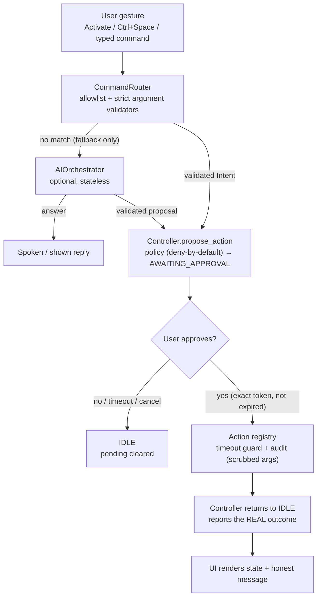

# JARVIS — Personal AI Assistant for Windows

JARVIS is a desktop assistant for Windows, built to **eventually** control a
laptop through voice commands. It now contains **Phase 1 (safe foundation)**,
**Phase 2 (voice input + spoken replies)**, **Phase 3 (structured, validated
command parsing)**, **Phase 4 (permission-controlled actions)**, **Phase 5
(optional AI conversation + local personalization)**, and **Phase 6 (hardening,
secret-redacted logging, and Windows packaging)**.

Phase 6 does not add new capabilities. It **hardens** what already exists:
redacted, size-bounded application logging; rotation for the audit log;
frozen-build path handling; a committed PyInstaller spec; a larger safety test
suite (startup/idle, approval, cancellation, malicious input, model/API failure,
duplicate execution); and complete setup, troubleshooting, uninstall, and
packaging documentation.

Phase 5 adds an **optional** AI helper. When no key is configured the assistant
behaves exactly as before (fully offline, rule-based). When a key *is* configured
(and the user leaves AI enabled), unrecognized requests are sent to an
OpenAI-compatible endpoint for a reply or a *proposed* action. The AI is a
**client only**: it can never execute anything, never bypass the allowlist or the
approval gate, and its output is validated against the same strict schema and
argument validators as typed commands.

Safety is the point. The assistant stays **IDLE by default**, never opens the
microphone on its own, never records continuously, and never executes anything
without an explicit, exact-match approval. Speech — and now model output — is
treated as **untrusted input**, not permission to act.

> **Safety at a glance:** idle by default · one utterance per activation ·
> deny-by-default allowlist · exact-match, expiring approvals · everything
> sandboxed and audited · AI is an optional *client* that can only reply or
> propose — it can never execute anything.

---

## Table of contents

- [Status](#status) · [Phase 1](#phase-1--safe-foundation) ·
  [Phase 2](#phase-2--voice-input-and-spoken-replies) ·
  [Phase 3](#phase-3--structured-validated-command-parsing) ·
  [Phase 4](#phase-4--permission-controlled-actions) ·
  [Phase 5](#phase-5--optional-ai-conversation--local-personalization) ·
  [Phase 6](#phase-6--hardening-logging-and-windows-packaging)
- [Requirements](#requirements)
- [Installation](#installation)
- [First run](#first-run)
- [Download the speech model](#download-the-speech-model-required-for-voice-input)
- [Microphone permissions](#microphone-permissions)
- [Run the application](#run-the-application) · [Try these commands](#try-these-commands)
- [Configuration](#configuration) · [Configuring the AI](#configuring-phase-5-optional-ai)
- [Building a Windows executable](#building-a-windows-executable)
- [Logging and privacy](#logging-and-privacy)
- [Run the tests](#run-the-tests)
- [Data flow](#data-flow)
- [Project structure](#project-structure)
- [How the safety model works](#how-the-safety-model-works)
- [Troubleshooting](#troubleshooting) · [Uninstall](#uninstall)
- [Technologies](#technologies) · [Known limitations](#known-limitations-phase-6)
- [Not implemented / not verified](#not-implemented--not-verified)
- [Phase 6 verification checklist](#phase-6-verification-checklist)

---

## Status

### Phase 1 — safe foundation
- Explicit state machine: `IDLE`, `LISTENING`, `AWAITING_APPROVAL`, `EXECUTING`.
- Safe transitions, cancellation, rejection, invalid-transition handling, and
  approval timeouts.
- Deny-by-default action policy with an allowlist.
- PySide6 window with status, activation, cancel/stop, and an approval panel.
- Automated tests (46).

### Phase 2 — voice input and spoken replies
- Microphone capture that starts **only** after explicit activation and records
  **one utterance per activation**, then stops.
- Offline speech-to-text with **Vosk** (no cloud).
- Text-to-speech with **pyttsx3** (local Windows voices).
- Microphone errors, no-speech timeouts, transcription failures, and
  cancellation are all handled and shown in the UI.
- Audio work runs on **worker threads** so the UI never freezes.
- A **typed command box** lets you exercise the whole flow without a microphone.
- 35 additional automated tests (81 total).

Not in Phase 2: real actions, wake-word/continuous listening, cloud services, or
operating-system control.

### Phase 3 — structured, validated command parsing
- A closed vocabulary of intents: `open_application`, `search_web`, `tell_time`,
  `list_directory`, `create_folder`, `cancel_command`, `unknown`.
- Speech/typed text is turned into an `Intent` **only** after its arguments pass
  strict validators (no path separators, no `..` traversal, no control
  characters, bounded length).
- `list_directory` / `create_folder` may target only the user's **named safe
  folders** (`home`, `desktop`, `documents`, `downloads`) — never an absolute or
  arbitrary path.
- `cancel_command` ("stop", "never mind", "cancel") is a **control** command: it
  stops everything and clears any pending proposal with **no approval**.
- Unknown or unsafe input returns no intent and yields a spoken clarification,
  then returns to `IDLE`.
- Parsing stays fully **offline and deterministic**; no LLM is involved.
- 79 additional automated tests (163 total).

Not in Phase 3: real actions (still "not implemented"), any cloud/LLM parsing,
wake-word listening, or operating-system control.

### Phase 4 — permission-controlled actions
- **Open an allowlisted application** (`open notepad`) — launched with
  `subprocess.Popen` and an explicit argument list, never `shell=True`.
- **Open an approved URL** (`go to example.com`) — http/https only, in the
  default browser.
- **Read a permitted directory** (`list files in documents`).
- **Create a folder in the workspace** (`create folder plans in documents`).
- **Open a permitted file** (`open notes.txt`, or pick one with **Open File…**).
- Every action is its own module under `actions/`, runs only after an exact-match
  approval, has a hard timeout, and is written to an **audit log** with its
  arguments scrubbed of secrets.
- A project-local **`workspace/` sandbox**: file actions can never reach a real
  user folder unless you deliberately reconfigure the folder map.
- **Dry-run mode** (`--dry-run`) reports what each action *would* do and touches
  nothing.
- 80 additional automated tests (244 total; all actions are mocked).

Not in Phase 4: destructive actions, arbitrary scripts, registry changes,
credential access, unrestricted system commands, mouse/keyboard automation, or
shutdown/deletion. Those remain permanently unsupported.

### Phase 5 — optional AI conversation + local personalization
- An isolated **`ai/` package**: a provider interface, a stdlib-`urllib`
  OpenAI-compatible client, a strict output **validator**, and an **orchestrator**
  that only ever returns a *reply* or a *proposal*.
- The AI is consulted **only as a fallback**, after the deterministic command
  router finds nothing. Rule-based commands never call the network.
- Configuration comes from **environment variables** (`JARVIS_LLM_API_KEY`,
  `JARVIS_LLM_BASE_URL`, `JARVIS_LLM_MODEL`, `JARVIS_LLM_TIMEOUT`). A `.env` file
  is loaded on startup but **never overrides** a real environment variable.
- **Strictly validated output.** Model JSON must match the expected shape; the
  command must be a **registered** action and every argument is re-checked with
  the existing `intents.py` validators (allowlisted apps, http/https only, safe
  extensions, safe folders, bounded lengths). Anything else is refused.
- An AI-proposed action is still just a **proposal** — it goes through the same
  exact-match approval as any other action and cannot execute on its own.
- **Prompt-injection resistant**: text in a model reply is only ever spoken; it
  cannot change policy or trigger an action.
- Optional **local storage** (`storage/`, a single SQLite file):
  - Command **history is off by default** (opt-in checkbox) and stores only the
    command text (truncated, control characters stripped) plus the action name and
    outcome — never audio, file contents, or keys.
  - A **Clear stored data** button deletes all history and preferences.
- **No new runtime dependencies**: the HTTP client is `urllib` and storage is
  `sqlite3`, both standard library.
- 99 additional automated tests (343 total; all network/provider calls mocked).

Not in Phase 5: AI as the primary parser (it is only a fallback), conversation
memory (each call is stateless), streaming, tool/function calling, voice cloning,
or any AI path that can execute an action without approval.

### Phase 6 — hardening, logging, and Windows packaging
- **Secret-redacted application logging** (`logging_setup.py`): a rotating file
  log at `logs/jarvis.log` (size-capped, with backups). Every handler passes
  through a filter that redacts the configured API key, bearer tokens,
  `password=…`/`token=…` pairs, and credentials embedded in URLs. The log never
  contains a secret.
- **Bounded audit log**: `logs/audit.log` now rotates too, keeping only the most
  recent backups instead of growing forever.
- **Frozen-build aware paths**: under PyInstaller, `.env`, `models/`, `logs/`,
  `data/`, and `workspace/` resolve next to the executable rather than into a
  temporary unpack directory.
- **A committed PyInstaller spec** (`jarvis.spec`) and documented build steps for
  a standalone `JARVIS.exe` (one-folder). The Vosk model stays external to keep
  the package small and license-clean.
- **A larger safety test suite** (384 tests, 1 skipped): startup opens no
  microphone; no action runs without a fresh, exact approval; approve/reject/
  timeout/cancel; malicious and ambiguous input; missing speech model; API/
  network failures; and duplicate-execution protection. All OS and network calls
  are mocked.
- **Docs**: installation, first run, microphone permissions, configuration,
  troubleshooting, uninstall, and build instructions, plus the data-flow diagram.

Not in Phase 6: code signing, an installer (MSI/Inno Setup), auto-update,
per-machine service installation, or bundling the speech model.

---

## Requirements

- Windows 10/11
- Python 3.10 or newer (developed against 3.12, 64-bit)
- A microphone (for voice input) and a Windows voice (for speech output)

## Installation

From the project folder (`Desktop\Jarvis`):

```powershell
# (optional but recommended) create and activate a virtual environment
python -m venv .venv
.\.venv\Scripts\Activate.ps1

# core app + tests
python -m pip install -e ".[dev]"

# voice input/output (Vosk, sounddevice, pyttsx3)
python -m pip install -e ".[voice]"

# everything, including the Windows packaging tools
python -m pip install -e ".[dev,voice,build]"
```

> On a Windows Store Python install you may hit `MAX_PATH` errors from PySide6.
> A project-local `.venv` (short path) avoids this; run commands through
> `.\.venv\Scripts\python.exe` if in doubt.

The **core app and the whole test suite run without the `voice` extra** — the
microphone, speech model, and text-to-speech are all optional and imported
lazily. Install `[voice]` when you want to actually talk to JARVIS.

### Download the speech model (required for voice input)

No model is bundled and nothing is downloaded automatically. Get the small
English Vosk model once, into `models/`:

```powershell
New-Item -ItemType Directory -Force models | Out-Null
Invoke-WebRequest -Uri "https://alphacephei.com/vosk/models/vosk-model-small-en-us-0.15.zip" -OutFile "models\vosk-model-small-en-us-0.15.zip"
Expand-Archive -Path "models\vosk-model-small-en-us-0.15.zip" -DestinationPath "models"
Remove-Item "models\vosk-model-small-en-us-0.15.zip"
```

Result (this exact path is what the app expects, see `config/settings.py`):

```
models\vosk-model-small-en-us-0.15\
```

The model is ~40 MB zipped / ~50 MB extracted and is **excluded from git** via
`.gitignore`. If the folder is missing, voice input reports a clear message and
the typed command box still works.

Model source: <https://alphacephei.com/vosk/models>

## First run

1. Install the app (see [Installation](#installation)).
2. Download the speech model (see above) **if you want voice input**.
3. (Optional) Copy `.env.example` to `.env` and add an AI key (see
   [Configuring the AI](#configuring-phase-5-optional-ai)).
4. Launch it:

   ```powershell
   python -m app.main
   ```

The window opens **IDLE** and does nothing until you act. Nothing is recorded,
no microphone is opened, no action runs, and (with no key) no network call is
made. Type `open notepad` and click **Send** to see the full
propose → approve → run flow without a microphone.

On first run JARVIS may create a few local files, all of which are git-ignored:
`logs\` (application + audit logs), `data\jarvis.db` (preferences/history, only
when used), and `workspace\` (the file-action sandbox).

## Microphone permissions

Windows controls microphone access per-app and per-user:

1. **Settings → Privacy & security → Microphone** and turn on
   *"Let apps access your microphone"*.
2. Make sure *"Let desktop apps access your microphone"* is enabled (JARVIS is a
   desktop app, so this is the relevant switch).
3. If you run from a terminal, the microphone is used by that terminal's app
   entry; ensure it has access.

JARVIS only opens the microphone **while listening** — from the **Activate**
button or **Ctrl+Space** — for a single utterance, then closes it. If capture
fails, the window shows a clear message and the typed command box still works.
No audio is ever written to disk or sent anywhere.

## Run the application

```powershell
python -m app.main
```

Add `--dry-run` to make every action report what it *would* do without launching
an application or changing any file:

```powershell
python -m app.main --dry-run
```

Two flags control the Phase 5 features for a single run:

```powershell
python -m app.main --no-ai        # disable AI even if a key is configured
python -m app.main --no-history   # start with command history off
```

The window opens in **IDLE**. Then:

- Click **Activate** or press **Ctrl+Space** to listen. The mic opens, captures
  **one** utterance, then closes. The transcript appears in the UI.
- If the transcript maps to an allowed action, it becomes a **proposal** and the
  approval panel appears — approve or reject it.
- Type a command in the box (e.g. `open notepad`, `go to example.com`,
  `list files in documents`, `create folder plans in documents`, `open
  notes.txt`) and click **Send** to test without a microphone.
- Use **Open File…** to pick a permitted file; it becomes an `open_file`
  proposal that still needs approval.
- **Cancel / Stop** stops any capture and clears any pending proposal. Typing
  `cancel` / `stop` does the same without needing approval.
- The small **Privacy / AI** panel shows whether AI is configured and lets you
  toggle **local command history** (off by default) and **Clear stored data**.

### Try these commands

Type these into the box (or say them after activating) to see the whole flow.
Every action is a **proposal** until you approve it.

| You type | What happens |
| --- | --- |
| `open notepad` | Proposes launching Notepad (allowlisted) → approve to run it. |
| `go to example.com` | Proposes opening the URL in your browser → approve. |
| `list files in documents` | Proposes listing the sandbox folder `documents`. |
| `create folder plans in documents` | Proposes creating `workspace\documents\plans`. |
| `open notes.txt` | Proposes opening a permitted file (or use **Open File…**). |
| `what time is it` | Replies honestly that the action is not implemented yet. |
| `cancel` / `stop` | Stops everything and clears any pending proposal — no approval. |
| `open powershell`, `open C:\Windows` | Refused (not allowlisted / unsafe path). |
| anything else | Rule-based miss → optional AI reply or proposal (if AI is enabled). |

## Configuration

Everything configurable lives in one file, `config/settings.py`. Nothing there
grants a capability; every value only *limits* what JARVIS may do.

### Actions, sandbox, and voice (`config/settings.py`)

- `APPLICATION_ALLOWLIST` — the only applications `open_application` may launch
  (name → argv). Prefer absolute paths to the executable.
- `WORKSPACE_ROOT` and `FOLDER_MAP` — the sandbox and how `home`/`desktop`/
  `documents`/`downloads` map into it.
- `SAFE_OPEN_EXTENSIONS` — the file types `open_file` may open.
- `EXECUTION_TIMEOUT_SECONDS`, `MAX_DIRECTORY_ENTRIES`, `DRY_RUN`,
  `AUDIT_LOG_PATH`, `AUDIT_LOG_MAX_BYTES`, `AUDIT_LOG_BACKUP_COUNT`.
- `APPROVAL_TIMEOUT_SECONDS` and `ACTIVATION_SHORTCUT`.
- Voice: `VOSK_MODEL_PATH`, `RECORD_MAX_SECONDS`, `SILENCE_TIMEOUT_SECONDS`,
  `NO_SPEECH_TIMEOUT_SECONDS`, `TTS_ENABLED`, `TTS_RATE`, `TTS_VOLUME`.
- Logging: `LOG_PATH`, `LOG_LEVEL`, `LOG_MAX_BYTES`, `LOG_BACKUP_COUNT`.
  Set `JARVIS_LOG_LEVEL` (e.g. `DEBUG`) in the environment or `.env` to change
  verbosity for a single run; an invalid value is ignored with a warning.

### Configuring Phase 5 (optional AI)

The AI is entirely optional. Without a key, nothing changes: the assistant stays
offline and rule-based.

Copy `.env.example` to `.env` and fill in your key (the file is git-ignored):

```powershell
Copy-Item .env.example .env
```

| Variable | Purpose | Default |
| --- | --- | --- |
| `JARVIS_LLM_API_KEY` | API key. **Required** to enable AI. | *(unset)* |
| `JARVIS_LLM_BASE_URL` | OpenAI-compatible base URL. | `https://api.openai.com/v1` |
| `JARVIS_LLM_MODEL` | Model name. | `gpt-4o-mini` |
| `JARVIS_LLM_TIMEOUT` | Request timeout, seconds. | `15` |
| `JARVIS_AI_ENABLED` | Set to `false` to force AI off. | *(on)* |
| `OPENAI_API_KEY` | Accepted as a fallback for the key. | *(unset)* |

Any OpenAI-compatible endpoint works (OpenAI, Azure OpenAI gateways, a local
server such as Ollama or LM Studio) — set `JARVIS_LLM_BASE_URL` accordingly and
put the key in `JARVIS_LLM_API_KEY` (a placeholder is fine for local servers).

**Privacy / cost note:** when AI is enabled, the *text of commands the rule-based
router does not recognize* is sent to the endpoint you configure, along with a
fixed system prompt. **No audio, no file contents, and no environment secrets are
ever sent.** Requests leave your machine, may incur provider costs, and require
network access. Prefer a local endpoint if you want to keep everything on-device.

Other Phase 5 settings in `config/settings.py`: `AI_MAX_PROMPT_CHARS`,
`AI_MAX_OUTPUT_CHARS`, `HISTORY_ENABLED_DEFAULT` (off), `HISTORY_MAX_ENTRIES`,
`HISTORY_TRANSCRIPT_MAX_CHARS`, `DATA_DIR`, `DATABASE_PATH`.

## Building a Windows executable

A committed PyInstaller spec produces a standalone, one-folder build.

```powershell
# 1. install the build tool (and the voice extras if you want voice in the exe)
python -m pip install -e ".[build,voice]"

# 2. build
pyinstaller --noconfirm jarvis.spec
```

The result is `dist\JARVIS\JARVIS.exe` alongside its dependencies.

**What is and is not bundled:**

- PySide6 and (when the `voice` extra was installed at build time) Vosk,
  sounddevice/PortAudio, and the SAPI5 TTS driver ship inside `dist\JARVIS\`.
- The **Vosk speech model is not bundled** (about 50 MB, separately licensed).
  Copy the extracted model to `dist\JARVIS\models\vosk-model-small-en-us-0.15\`.
  Without it, voice input reports a clear message; typed commands still work.
- `.env` is not bundled. Put a `.env` **next to `JARVIS.exe`** if you want AI.
- `logs\`, `data\`, and `workspace\` are created beside the executable at
  runtime. (Under a frozen build the app treats the executable's folder as its
  root, so these paths just work.)

**Rebuilding / cleaning:** delete `build\` and `dist\` before a fresh build.
`build\` and `dist\` are git-ignored; `jarvis.spec` is committed.

> The build output is **not code-signed**. Windows SmartScreen may warn on first
> run; this is expected for an unsigned local build and is documented as a
> limitation below.

## Logging and privacy

JARVIS writes two local, git-ignored logs:

| File | What it holds | Retention |
| --- | --- | --- |
| `logs\jarvis.log` | Lifecycle and diagnostic events | rotated at `LOG_MAX_BYTES`, keeps `LOG_BACKUP_COUNT` backups |
| `logs\audit.log` | One JSON line per action attempt, with scrubbed arguments | rotated at `AUDIT_LOG_MAX_BYTES`, keeps `AUDIT_LOG_BACKUP_COUNT` backups |

Both are **secret-redacted**. The application log passes through a filter that
removes the configured API key, bearer tokens, `password=`/`token=secret`-style
pairs, and credentials embedded in URLs. The audit log reduces URLs to
`scheme://host` and replaces any sensitive-keyed argument with `[redacted]`.
**No API key is ever written to a log, and no audio or document contents are
ever logged.**

Privacy summary: audio stays on the machine; the database stores only an
optional, off-by-default command history; the only outbound data is the
unrecognized command text sent to the AI endpoint **when AI is enabled**.

## Run the tests

```powershell
python -m pytest
```

The suite uses fake audio components and **mocks every OS call and every network
call**, so it needs **no microphone, no model, no display, no browser, no API key,
and it never launches an application, contacts a server, or changes your files**.

---

## Data flow

How one command travels through the app, and where the safety gates are:



Key points the diagram encodes:

- The **router** and the **AI** can each reach the proposal gate, but **neither
  can reach execution**. Only an explicit, exact, unexpired approval does.
- The **AI is a fallback** — it is consulted only when the router returns nothing.
- Every executed action passes through the **timeout guard** and the **audit
  log**, then the controller reports the true result (success, failure, timeout,
  or "not started").

---

## Project structure

```
Jarvis/
├── app/
│   ├── __init__.py
│   └── main.py              # Entry point: builds QApplication + window
├── audio/                   # Phase 2: Qt-free audio layer
│   ├── __init__.py
│   ├── errors.py            # AudioError and subclasses
│   ├── microphone.py        # MicrophoneRecorder (sounddevice, lazy import)
│   ├── stt.py               # SpeechToText protocol + VoskSpeechToText
│   └── tts.py               # TextToSpeech protocol + Pyttsx3/Null TTS
├── actions/                 # Phase 4: permission-controlled actions
│   ├── __init__.py
│   ├── base.py              # ActionResult, ActionContext, error types
│   ├── paths.py             # Workspace confinement + root resolution
│   ├── audit.py             # File/Null audit logger + secret redaction
│   ├── open_application.py  # Launch an allowlisted app
│   ├── open_url.py          # http/https URL validation + open
│   ├── list_directory.py    # Read a permitted directory
│   ├── create_folder.py     # Create a folder inside the workspace
│   ├── open_file.py         # Open a permitted file (extension allowlist)
│   └── registry.py          # Handler table + timeout-guarded executor
├── ai/                      # Phase 5: optional, isolated LLM client
│   ├── __init__.py
│   ├── errors.py            # AIError hierarchy (timeout, unavailable, invalid)
│   ├── config.py            # AIConfig + env loading (secret-safe repr)
│   ├── env.py               # Dependency-free .env loader
│   ├── provider.py          # ChatMessage/LLMResponse/LLMProvider interface
│   ├── providers/
│   │   ├── __init__.py
│   │   ├── null_provider.py        # Always-unavailable, for "no key"
│   │   └── openai_compatible.py    # urllib /chat/completions client
│   ├── schemas.py           # Strict model-output validation (safety gate)
│   ├── client.py            # AIClient + build_provider
│   ├── responder.py         # Conversational prompt + local fallback replies
│   └── orchestrator.py      # interpret() -> answer | proposal | unavailable
├── storage/                 # Phase 5: local SQLite prefs + optional history
│   ├── __init__.py          # open_storage() + resolve_db_path()
│   ├── db.py                # Database wrapper + schema/version
│   ├── preferences.py       # History/AI preferences (flags)
│   └── history.py           # Opt-in command history (truncated, scrubbed)
├── core/                    # Qt-free domain + orchestration
│   ├── __init__.py
│   ├── states.py            # AssistantState enum
│   ├── state_machine.py     # Transition table + InvalidTransitionError
│   ├── controller.py        # State/policy/approval/execution authority
│   ├── intents.py           # Phase 3: Intent vocabulary + argument validators
│   ├── command_router.py    # Phase 3: text -> validated Intent (or None)
│   ├── voice_pipeline.py    # Phase 2: record -> transcribe -> route
│   └── assistant.py         # Phase 2/3: orchestration (proposal, reply, cancel)
├── security/                # Guardrails
│   ├── __init__.py
│   ├── actions.py           # ActionSpec + ActionRegistry (the allowlist)
│   ├── policy.py            # ActionPolicy: deny-by-default
│   └── approval.py          # Expiring, exact-match ApprovalRequest
├── ui/
│   ├── __init__.py
│   ├── workers.py           # Phase 2: QThread workers (listen, speak)
│   └── main_window.py       # PySide6 window
├── tests/
│   ├── __init__.py
│   ├── fakes.py             # Phase 2: fake recorder/STT/TTS + clock
│   ├── test_state_machine.py
│   ├── test_policy.py
│   ├── test_approval.py
│   ├── test_controller.py
│   ├── test_command_router.py   # Phase 2/3/4
│   ├── test_intents.py          # Phase 3
│   ├── test_voice_pipeline.py   # Phase 2
│   ├── test_assistant.py        # Phase 2/3/4
│   ├── test_action_paths.py          # Phase 4
│   ├── test_action_open_application.py
│   ├── test_action_open_url.py
│   ├── test_action_list_directory.py
│   ├── test_action_create_folder.py
│   ├── test_action_open_file.py
│   ├── test_executor_registry.py
│   ├── test_actions_integration.py
│   ├── test_storage.py              # Phase 5
│   ├── test_ai_env.py               # Phase 5
│   ├── test_ai_config.py            # Phase 5
│   ├── test_ai_provider.py          # Phase 5
│   ├── test_ai_schemas.py           # Phase 5
│   ├── test_ai_client.py            # Phase 5
│   ├── test_ai_orchestrator.py      # Phase 5
│   ├── test_ai_assistant_integration.py   # Phase 5
│   ├── test_logging_setup.py        # Phase 6
│   ├── test_main_window.py          # Phase 6 (offscreen UI)
│   └── test_speech_model_missing.py # Phase 6
├── models/                  # Vosk model (downloaded; git-ignored)
├── workspace/               # Phase 4 sandbox for file actions (git-ignored)
├── logs/                    # app log + audit log (git-ignored)
├── data/                    # Phase 5 SQLite store (git-ignored)
├── config/
│   ├── __init__.py
│   └── settings.py          # Timeout, shortcut, allowlist, voice/AI/log config
├── logging_setup.py         # Phase 6: redacted, rotating application logger
├── jarvis.spec              # Phase 6: PyInstaller build spec
├── pyproject.toml           # Metadata, dependencies, pytest config
├── .env.example             # Phase 5: template for AI config (key blank)
├── .gitignore
└── README.md
```

### What each part does

- **`app/main.py`** — starts Qt and shows the window. Nothing else runs on
  startup; no microphone is opened.
- **`audio/`** — the hardware boundary. Qt-free and controller-free. Every
  third-party import (`sounddevice`, `vosk`, `pyttsx3`) is lazy, so the app and
  tests work even without the voice extras.
  - `microphone.py` yields fixed-size PCM blocks, stops on a flag or a hard time
    limit, and always closes the device.
  - `stt.py` loads the Vosk model lazily and raises a clear error if it is
    missing.
  - `tts.py` speaks with the local Windows voice; failures are swallowed so they
    never break the assistant.
- **`actions/`** — Phase 4. The only code allowed to touch the OS. Each action is
  a small, independent module with the same shape: validate → do the one thing →
  return an `ActionResult`. Qt-free and controller-free.
  - `base.py` defines `ActionResult` (never raise to the caller), `ActionContext`
    (permitted folders, app allowlist, extensions, timeout, dry-run, audit), and
    the action error types.
  - `paths.py` confines every file operation to the workspace: arguments are
    resolved and checked with `Path.resolve()` + `is_relative_to`, so `..` and
    symlink escapes are refused.
  - `audit.py` appends one JSON line per attempt to `logs/audit.log`, with URL
    credentials/tokens and other secrets redacted.
  - `registry.py` maps action names to handlers and wraps each call with a
    **timeout guard** (a one-shot daemon thread) so a stuck action cannot hang the
    assistant.
- **`ai/`** — Phase 5. The optional, isolated AI client. It can *only* turn text
  into a reply or a proposal; it has no reference to the controller, the executor,
  or the registry, so it cannot run anything.
  - `provider.py` / `providers/` define the interface and two implementations: a
    `NullProvider` (always unavailable, used when no key is set) and an
    OpenAI-compatible client built on stdlib `urllib` with a request timeout and a
    hard response-size cap. The key is sent as a bearer token and is never logged.
  - `config.py` reads configuration from the environment and never echoes the key
    (its `repr` shows `<set>`/`<unset>`).
  - `env.py` is a tiny `.env` loader: real environment variables always win.
  - `schemas.py` is the **safety gate**. It parses the model's JSON, rejects
    anything malformed or oversized, requires the action name to be **registered**,
    and re-validates every argument with the same validators the router uses.
  - `orchestrator.py` returns exactly one of `AIAnswer` (spoken text),
    `AIProposal` (a *candidate* action for the normal approval flow), or
    `AIUnavailable` (with a safe local fallback reply).
- **`storage/`** — Phase 5. Qt-free local persistence in one SQLite file.
  - `db.py` opens the database, records a schema version, and runs simple queries.
  - `preferences.py` stores boolean flags (history on/off, AI on/off).
  - `history.py` records commands **only when enabled**, truncates long text, and
    strips control characters. Nothing sensitive is ever written.
- **`core/`** — the "brain". Pure Python.
  - `state_machine.py` declares every legal move in one table.
  - `controller.py` is the only place states change; it enforces policy and
    approvals, then interprets the returned `ActionResult` (success/failure/detail)
    so the UI never reports a false success.
  - `intents.py` defines the small, closed vocabulary of intents and the strict
    validators that every argument must pass before an `Intent` may exist.
  - `command_router.py` is the **untrusted-text boundary**: only a few phrase
    shapes are recognized, `open_application` targets must be in the app
    allowlist, URL schemes are limited to http/https, open-file extensions are
    checked, and arguments are validated/bounded. `cancel_command` is a control
    intent and is not gated. It returns an *intent*, never an execution.
  - `voice_pipeline.py` records one utterance, detects speech by RMS energy,
    transcribes, routes, and returns a `ListenResult`. It never touches the
    controller.
  - `assistant.py` orchestrates: OK transcript → proposal (or a spoken reply),
    `cancel_command` → immediate stop with no approval, errors → spoken reply then
    back to IDLE. When the router returns nothing and an AI is available, it asks
    the orchestrator for a fallback reply or a proposal — the proposal still flows
    through the same policy + approval gate. It exposes `propose_action()` so the UI
    can offer a proposal (e.g. an "Open File…" pick) without executing anything
    itself.
- **`security/`** — the guardrails (allowlist, deny-by-default policy, expiring
  exact-match approvals).
- **`ui/`** — presentation and threading.
  - `workers.py` runs capture/transcription and speech on their own `QThread`s.
  - `main_window.py` renders the real state and forwards user gestures; it builds
    the action executor and shows a friendly description of each proposal.
- **`config/settings.py`** — one place for the approval timeout, shortcut,
  allowlists (actions and applications), workspace/folder map, safe extensions,
  execution timeout, dry-run default, audit path, logging, and all voice settings.
- **`logging_setup.py`** — Phase 6. Configures a rotating file logger with a
  filter that redacts secrets before any handler sees a record. Idempotent and
  best-effort: a logging problem never stops the app.
- **`jarvis.spec`** — Phase 6. The PyInstaller spec for the Windows build (see
  [Building a Windows executable](#building-a-windows-executable)).
- **`workspace/`** — the sandbox where file actions operate. Created on demand and
  git-ignored.
- **`logs/`** — `jarvis.log` (redacted, rotating) and `audit.log` (JSON lines,
  rotating). Created on demand and git-ignored.

---

## How the safety model works

1. **Idle by default.** The controller starts in `IDLE`. The only way to listen
   is the **Activate** button or **Ctrl+Space**. No microphone is opened at
   startup, and never in `IDLE`.
2. **One utterance, then off.** While `LISTENING`, the mic records a single
   utterance (capped at `RECORD_MAX_SECONDS`), then the device is closed. There
   is no continuous listening and no wake word.
3. **Speech is untrusted.** The transcript goes through `CommandRouter`, which
   only recognizes a few phrase shapes and only for **allowlisted** actions.
   Arguments must pass the validators in `intents.py` (no path separators, no
   `..`, no control characters, bounded length) and folder locations are limited
   to named safe folders. Anything else is refused. Recognition never runs an
   action.
4. **Exact approval.** An allowed phrase becomes an `ApprovalRequest` holding the
   exact action, a frozen copy of the arguments, a SHA-256 fingerprint, a random
   token, and a deadline. It is still just a proposal.
5. **Stale approvals rejected.** `approve(token)` only accepts the current
   proposal's token; an older or wrong token raises `StaleApprovalError`.
6. **Timeouts.** Past the deadline (default 30 s) the proposal is discarded and
   the assistant returns to `IDLE`; the UI polls `check_timeout()`.
7. **Cancel wins.** `cancel()` clears the pending proposal and asks the audio
   worker to stop, so a not-yet-started action can never run. Saying or typing
   `stop` / `cancel` triggers this directly, with **no approval** — a control
   command is never gated by the action allowlist.
8. **Actions are sandboxed and bounded.** File actions run only inside the
   project-local `workspace/`; `open_application` only launches names in
   `APPLICATION_ALLOWLIST` using an explicit argument list (`shell=False`);
   `open_url` only accepts http/https and rejects embedded credentials; and
   `open_file` only opens extensions in `SAFE_OPEN_EXTENSIONS`. Every action has
   a hard timeout and returns a plain `ActionResult` instead of raising.
9. **Every attempt is audited.** `logs/audit.log` records one JSON line per action
   attempt (success or failure) with a redacted argument set — never a secret.
10. **No false success.** The UI shows the executor's real outcome. Actions that
    are implemented report what actually happened; actions that are **not**
    implemented (e.g. `tell_time`, `set_volume`) report "not implemented" — never
    "success". A timed-out or failed action is shown as such.
11. **Dry-run is available.** With `--dry-run` (or `DRY_RUN=True`) each action
    reports what it *would* do and changes nothing.
12. **Local by default; the AI is opt-in and isolated.** Vosk and pyttsx3 are
    entirely local, and audio never leaves the machine. The optional AI is the
    **only** feature that makes a network call, only when a key is configured, and
    only for text the router did not recognize. It never receives audio, file
    contents, or secrets.
13. **AI cannot act.** The `ai/` package imports none of the controller, executor,
    or registry. Its only outputs are a *reply* or a *proposal*. A proposal goes
    through the identical policy + approval path as a typed command, so **no model
    output can ever execute an action on its own**.
14. **Model output is untrusted and validated.** Text is parsed as strict JSON,
    rejected if malformed or oversized, required to name a **registered** action,
    and every argument is re-checked with the same validators as the router
    (allowlisted apps, http/https only, safe extensions, safe folders, bounded
    length). Unknown actions — including prompt-injection attempts — are refused.
15. **Injection cannot change policy.** A model that *says* something dangerous can
    only have that sentence spoken; it cannot alter the allowlist, the approval
    requirement, or trigger anything.
16. **Storage is minimal and opt-in.** Command history is off unless you enable it,
    stores only truncated command text plus the action name/outcome, and can be
    cleared with one button. No credentials are ever persisted.
17. **Logs are redacted and bounded.** The application log and the audit log both
    pass through secret-scrubbing and rotate at a fixed size, so a secret cannot
    leak and a log cannot grow without bound.

---

## Troubleshooting

| Symptom | Cause | Fix |
| --- | --- | --- |
| `ModuleNotFoundError: PySide6` | Core deps not installed | `python -m pip install -e ".[dev]"` |
| "Audio capture is unavailable because 'sounddevice' is not installed" | Voice extra missing | `python -m pip install -e ".[voice]"` |
| "Vosk model not found at …" | Model not downloaded | See [Download the speech model](#download-the-speech-model-required-for-voice-input) |
| Microphone never hears anything | Windows mic permission, wrong device, or all-silence | Check [Microphone permissions](#microphone-permissions); speak within ~6 s |
| "No speech detected" every time | Input too quiet or wrong device | Raise input level in Windows; consider a different default mic |
| Voice does nothing but typed commands work | The above — typed path needs no mic | Use the typed command box while you fix audio |
| `AI: unavailable` in the panel | No key configured | Set `JARVIS_LLM_API_KEY` in `.env`, or ignore (AI is optional) |
| AI proposals never appear | Model returned malformed output, or the action isn't registered | Expected: only registered actions are ever proposed; check `logs\jarvis.log` |
| App is slow to start when packaged | One-folder build extracting | Normal on first launch; subsequent launches are faster |
| SmartScreen warning on the packaged exe | The build is unsigned | Expected; see the packaging note above |
| `MAX_PATH`/path errors with PySide6 | Windows Store Python | Use a short project-local `.venv` |

Diagnostics: check `logs\jarvis.log` (redacted). For an action that did not run
as expected, `logs\audit.log` shows one JSON line per attempt with the outcome.

## Uninstall

JARVIS keeps everything inside its own folder; uninstalling is just deleting it.

```powershell
# from the project folder
deactivate            # if a venv is active

# remove the Python environment and any local data
Remove-Item -Recurse -Force .venv
Remove-Item -Recurse -Force data, logs, workspace, models
```

If you installed the package into a shared interpreter, remove it with:

```powershell
python -m pip uninstall jarvis-assistant
```

For a packaged build, delete the `dist\JARVIS\` folder (and the `models\`,
`logs\`, `data\`, `workspace\` folders inside it). Nothing is written to the
Windows registry, and no per-machine service is installed.

---

## Technologies

- **Python 3.10+** — the language.
- **PySide6 (Qt for Python)** — widgets, signals/slots, `QShortcut`, `QTimer`,
  and `QThread` for background work.
- **Vosk** — offline speech-to-text (needs the model above).
- **sounddevice** — microphone capture via PortAudio. `RawInputStream` gives raw
  PCM bytes, so **numpy is not required**.
- **pyttsx3** — text-to-speech using local Windows SAPI5 voices.
- **Standard library** (`subprocess`, `webbrowser`, `os.startfile`, `pathlib`) —
  Phase 4 actions, always with explicit argument lists and no shell.
- **Standard library** (`urllib.request`, `json`) — Phase 5 AI HTTP client. **No
  third-party HTTP or AI SDK is used.**
- **Standard library** (`sqlite3`) — Phase 5 local preferences and history. No ORM,
  no external database.
- **Standard library** (`logging`, `logging.handlers`) — Phase 6 redacted,
  rotating application log. No third-party logging library.
- **PyInstaller** (optional, `[build]`) — Phase 6 Windows packaging. Build-time
  only; not a runtime dependency.
- **pytest** — the test runner.

---

## Known limitations (Phase 6)

- Only five actions are implemented: `open_application`, `open_url`,
  `list_directory`, `create_folder`, `open_file`. Other allowlisted intents
  (`tell_time`, `set_volume`, `search_web`) report "not implemented".
- File actions operate **only inside `workspace/`**. They cannot reach a real user
  folder unless you deliberately point `FOLDER_MAP` at one (not recommended).
- Cancellation prevents a **not-yet-started** action from running, but it cannot
  reliably reverse an OS-level action that is already executing (e.g. an app that
  has already launched).
- The timeout guard runs each action on a one-shot daemon thread; a genuinely
  stuck action is reported as timed out but its underlying thread cannot be
  force-killed.
- No wake word and no continuous listening; one command per activation.
- Speech detection uses a simple RMS energy threshold (not a VAD model), so noisy
  rooms may behave imperfectly.
- Transcription is batch (whole utterance), not streaming partials.
- The Vosk small English model is the only supported model out of the box;
  another model works by pointing `VOSK_MODEL_PATH` at it.
- TTS uses the system's default voice; voice selection is not exposed in the UI.
- Parsing is a small set of literal phrase shapes (deterministic, offline), not a
  general natural-language parser; phrasings outside those shapes are refused
  (then optionally offered to the AI).
- Sub-paths within a folder are not yet supported (e.g. `documents\2026`).
- **AI is a fallback only** and is **stateless**: each request contains just the
  current message plus a fixed system prompt — there is no conversation memory.
- **AI quality and availability depend on the provider** you configure. Timeouts,
  HTTP errors, and malformed output all fall back to a safe local message; the
  assistant never blocks on the network.
- **AI behavior is not perfectly predictable.** Validation constrains it to the
  registered actions and strict arguments, but a model reply is still
  model-generated text; treat it as advisory, and remember every action still
  needs your explicit approval.
- **Data leaves the machine only when AI is enabled** (and only the unrecognized
  command text + system prompt). Disable AI (no key, or `--no-ai`, or
  `JARVIS_AI_ENABLED=false`) to stay fully offline.
- Indexing/search over stored history is not implemented; the store is for
  preferences and a simple recent-commands list.

Phase 6 additions:

- **The packaged build is not code-signed.** Windows SmartScreen may show a
  warning on first run. Signing requires a certificate and is out of scope.
- **The speech model is not bundled** in the executable; it must be placed in
  `models\` beside the exe (keeps the build small).
- **The application log is diagnostic, not tamper-evident.** It is redacted and
  rotated, but it is an ordinary text file, not a secure audit trail.
- **Rotation is size-based only** (no time-based or compression policy); old
  backups are deleted once `*_BACKUP_COUNT` is reached.
- **Cancellation of an already-running OS action** and the un-killable timeout
  thread remain as described above — Phase 6 added tests, not new capabilities.
- **The frozen-path behaviour is verified by construction and documentation**;
  see the honesty note below for exactly what was and was not run.

## Not implemented / not verified

To be explicit about the current state (no overclaiming):

**Not implemented (by design, permanently unsupported):** destructive actions,
arbitrary scripts, registry changes, credential access, shell command execution,
mouse/keyboard automation, and shutdown/deletion.

**Implemented but limited:** `tell_time`, `set_volume`, and `search_web` are
allowlisted but report "not implemented" when approved. There is no wake word,
no continuous listening, and no conversation memory.

**Not verified in this environment:** a live AI provider call (the test suite
mocks every network call; no key is configured), and the downloaded Vosk model
transcribing real speech (the model is git-ignored and was not downloaded here —
the missing-model path **is** tested). The packaged executable was built and
launched in this environment; behaviour on a locked-down machine without a
display or microphone is not verified.

---

## Phase 6 verification checklist

Automated (run these):

- [ ] `python -m pytest -q` passes — **384 tests, 1 skipped** (all OS and network
      calls mocked; no microphone, model, display, or API key required).
- [ ] `python -m compileall -q app config core security actions ai storage ui app/main.py logging_setup.py`
      reports no errors.
- [ ] `python -m app.main` opens in **IDLE**; `logs\jarvis.log` is created.

Manual (spot checks):

- [ ] The window starts **IDLE**, opens **no** microphone, and runs **no** action.
- [ ] The only ways to listen are **Activate** / **Ctrl+Space**.
- [ ] A typed command becomes a **proposal**; nothing runs until you approve it.
- [ ] Reject, timeout, and Cancel all clear the proposal and run nothing.
- [ ] An unregistered/destructive request is refused with no proposal.
- [ ] With no key, `AI: unavailable` and no network call is made.
- [ ] The API key never appears in `logs\jarvis.log`, `logs\audit.log`, or any
      `repr`.
- [ ] `logs\jarvis.log` and `logs\audit.log` rotate (backups appear) and stay
      bounded.
- [ ] `data\jarvis.db`, `logs\`, and `workspace\` are created on demand and are
      git-ignored; `.env` is git-ignored but `.env.example` is committed.

Packaging (run these):

- [ ] `python -m pip install -e ".[build,voice]"` completes.
- [ ] `pyinstaller --noconfirm jarvis.spec` produces `dist\JARVIS\JARVIS.exe`.
- [ ] Copying the model into `dist\JARVIS\models\…` enables voice in the packaged
      app; `.env` beside the exe enables AI.

---

## Committing

This is Phase 6. Review the changes and run the tests, then commit (and push
only when you are ready):

```powershell
git add .
git commit -m "Phase 6: hardening, secret-redacted logging, and Windows packaging"
# git push   # only when you explicitly want to publish
```
